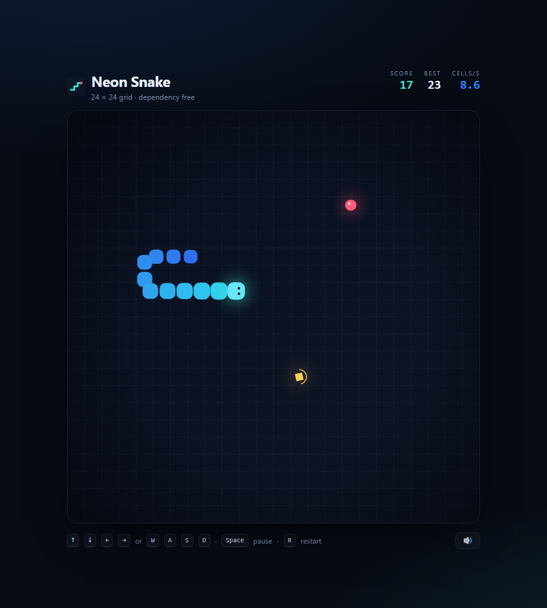

# Neon Snake

A dependency-free Snake game built to feel good rather than to show off a framework.
Everything is hand-written: no bundler, no engine, no tracking script. Open the file and play.

**▶ Play: https://sixpencecn.github.io/neon-snake/**



---

## What makes it feel right

| Detail | Why it exists |
|---|---|
| **Interpolated motion** | The simulation runs on a fixed grid step; rendering interpolates between the previous and current cell, so the snake glides instead of snapping. |
| **Two-deep input buffer** | Fast double turns (right→up→left) are not lost. The buffer rejects 180° reversals and duplicate directions, so you never kill yourself with a misread keypress. |
| **Pacing curve** | 7.1 cells/s at the start, tightening to ~16 as the snake grows, floored so it stays humanly playable. |
| **Golden shards** | Every 5 apples drops a timed bonus worth 5 points. It has a visible countdown ring, so the risk/reward read is instant. |
| **Juice that stays tasteful** | Particle bursts, a brief screen flash, a death shake, and interpolated glow — all suppressed when the OS asks for reduced motion. |
| **Synthesised audio** | Sound effects are generated with the Web Audio API at runtime. No `mp3`, no autoplay surprises, muting persists. |
| **Touch input** | Swipe to turn, tap to pause, plus an on-screen D-pad that only appears on coarse pointers. |
| **High score** | Persisted in `localStorage`, combined with a "new best" state on the game-over screen. |

## Controls

| Action | Keyboard | Touch |
|---|---|---|
| Turn | `↑` `↓` `←` `→` or `W` `A` `S` `D` | Swipe, or the D-pad |
| Start / resume | `Space` · `Enter` | Tap the overlay |
| Pause | `Space` | Tap the board |
| Restart | `R` | Tap after game over |
| Mute | `M` | Speaker button |

## Architecture

```
index.html          markup, styles, layout — no logic
game.js             pure simulation: grid, snake, food, pacing, collisions
app.js              rendering, input, audio, rAF loop, persistence
test/selftest.html  19 assertions against game.js, runnable in any browser
```

`game.js` deliberately has **no DOM, no timers, and no rendering assumptions**. It is
seedable, which makes it deterministic — that is what allows the test suite to assert on
collisions, bonus spawning and win conditions without mocking anything.

The renderer reads simulation state but never mutates it. `renderCell(index, t)` is the
entire bridge between them.

## Tests

Open `test/selftest.html` in a browser (or serve it) — 19 assertions run on load, covering:

- spawn rules and food never overlapping the snake
- reversal / duplicate-direction rejection and buffer depth
- wall and self collisions, including the "tail is vacating" case
- growth, scoring, bonus spawn cadence and bonus expiry
- pacing floor, interpolation endpoints, seed determinism, board-fill win

## Running locally

No build step. Either open `index.html` directly, or serve the folder:

```bash
python -m http.server 8080
# → http://localhost:8080
```

## License

MIT © 2026 sixpencecn
